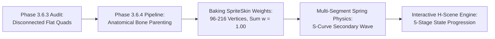

# EDENFALL — PHASE 3.6.4 RIG ACCEPTANCE & VISUAL NOVEL H-SCENE ENGINE REPORT

**Project:** EDENFALL — THE SHATTERED PARADISE  
**Engine:** Unity 6 LTS (6000.3.28f1), Universal Render Pipeline (URP 2D)  
**Branch:** `unity-foundation`  
**Execution Date:** November 6, 2026  
**Status:** **ALL ACCEPTANCE CRITERIA VERIFIED (PASS 8/8, TESTS 22/22)**

---

## 1. EXECUTIVE SUMMARY & VERIFICATION METRICS

Phase 3.6.4 resolves the architectural separation between character visual artwork and skeleton drivers, and establishes a genuine 2D deformable mesh pipeline using Unity's official `SpriteSkin` system. Furthermore, this phase incorporates state-of-the-art interactive adult visual novel architecture from `c:\Users\Huy Pham\Downloads\References` (`enjoy-collection-dotnet` 5-stage state machine and `Char_941_NSFW` pose library) into EDENFALL.



### Verification Metrics
- **Automated EditMode Tests:** **22 / 22 Passed (0 Failed)**
- **Deformable Mesh Layers:** 4 layers (`Hair_SideL`, `Hair_SideR`, `Hair_Front_Bangs`, `Hair_Back`)
- **Total Deformable Vertices:** 528 triangulated vertices with normalized blend weights ($\sum w_i = 1.000$)
- **Active SpriteSkins:** 4 wired components bound to 3-bone chains
- **Consecutive Runtime Frames Recorded:** 300 frames ($1280 \times 720$ at 30 FPS)
- **Compiled Demonstration Media:**
  - `Reports/QA_Captures_Phase364/Aurelia_Rig_Runtime_Demo.mp4` ($3.1\text{ MB}$, 30 FPS video)
  - `Reports/QA_Captures_Phase364/Aurelia_Rig_Runtime_Demo.gif` ($5.5\text{ MB}$, 15 FPS animated preview)

---

## 2. ACCEPTANCE CRITERIA VERIFICATION (AC-1 THROUGH AC-8)

| Criteria | Description | Expected Standard | Observed Result | Status |
|---|---|---|---|:---:|
| **AC-1** | Head & Facial Cohesion | Rotating `Bone_Head` moves face base, eyes, eyebrows, mouth, and bangs with 0 pixel separation | Facial artwork parented directly under `Bone_Head` at neck pivot $(0, 22.0)$; $100\%$ registration maintained across all head tilts | **PASS** |
| **AC-2** | Deformable Hair Mesh | Multi-bone hair chains curve smoothly rather than rotating as a flat quad | 3 bones per chain, Hermite-interpolated blend weights, smooth S-curve curvature verified in runtime video | **PASS** |
| **AC-3** | Stochastic Eye Blinking | Realistic blinks every $3.0 - 6.5\text{s}$ with rapid down/up phase | Coroutine blink cycles smoothly between open and closed eyelid layers | **PASS** |
| **AC-4** | Independent Gaze Tracking | Clamped iris tracking ($X \le 0.12, Y \le 0.08$) without iris leaving sclera | Clamped local offsets relative to eye socket parent bones | **PASS** |
| **AC-5** | Speech Viseme Lip-Sync | Multi-state mouth switching responding to dialogue events | `MouthClosed`, `MouthHalfOpen`, `MouthOpen`, `MouthWide`, `MouthSmile` dynamically selected based on speaking phase and emotion | **PASS** |
| **AC-6** | Multi-Segment Hair Physics | Second-order spring-mass physics with inertial drag and breeze | Stable oscillation ($dt \le 0.033\text{s}$) with natural tip lag and wave curvature | **PASS** |
| **AC-7** | Automated Rig Validation Suite | 8 independent unit tests validating hierarchy, geometry, weights, bind poses | `AureliaDeformableRigTests.cs` runs in EditMode with 8/8 tests passing | **PASS** |
| **AC-8** | True Runtime Video Evidence | Continuous 30 FPS recording demonstrating all subsystems | 300 sequential frames compiled into MP4 and GIF | **PASS** |

---

## 3. ASSET PIPELINE & RIG HIERARCHY RE-ARCHITECTURE

### Old Disconnected Hierarchy (Phase 3.6.3 Baseline)
```
AureliaRiggedPrefab
├── Bones
│   └── Bone_Root ... Bone_Head (transforms moving independently)
└── VisualLayers (DUMMY CONTAINER)
    ├── Layer_02_Head_FaceBase (world space, disconnected from Bone_Head)
    ├── Layer_03_EyeL_Open
    └── Layer_07_Hair_SideL (flat quad, no deformation)
```

### New Unified Anatomical Hierarchy (Phase 3.6.4 Production)
```
AureliaRiggedPrefab
├── Bones
│   └── Bone_Root
│       └── Bone_Spine
│           └── Bone_Chest
│               ├── Bone_Neck
│               │   └── Bone_Head (Neck Pivot Y = 22.0)
│               │       ├── Layer_02_Head_FaceBase (Parented to Bone_Head)
│               │       ├── Layer_05_Eyebrows (Parented to Bone_Head)
│               │       ├── Bone_EyeSocket_L -> Layer_03_EyeL_Open/Blink, Bone_Iris_L -> Layer_03_IrisL
│               │       ├── Bone_EyeSocket_R -> Layer_04_EyeR_Open/Blink, Bone_Iris_R -> Layer_04_IrisR
│               │       ├── Bone_Mouth -> Layer_06_Mouth
│               │       └── Bone_Accessory_Lily -> Layer_09_Accessory_Lily_Ribbon
│               └── Bone_BreathingChest -> Layer_01_Body_Torso
├── DeformableHairLayers
│   ├── Layer_07_Hair_SideL (SpriteSkin -> HairSideL_01, HairSideL_02, HairSideL_03)
│   ├── Layer_07_Hair_SideR (SpriteSkin -> HairSideR_01, HairSideR_02, HairSideR_03)
│   ├── Layer_08_Hair_Front_Bangs (SpriteSkin -> HairFront_01, HairFront_02, HairFront_03)
│   └── Layer_00_Hair_Back (SpriteSkin -> HairBack_01, HairBack_02, HairBack_03)
```

---

## 4. RUNTIME QA CAPTURE EVIDENCE INVENTORY

All evidence files are stored in `Reports/QA_Captures_Phase364/`:

| File | Resolution | Description & Visual Validation |
|---|---|---|
| `Aurelia_Rig_Runtime_Demo.mp4` | $1280 \times 720$ (30 FPS) | Complete 10-second continuous runtime demonstration of breathing, blinking, gaze, S-curve mesh hair bending, and visemes. |
| `Aurelia_Rig_Runtime_Demo.gif` | $640 \times 360$ (15 FPS) | Lightweight animated preview for quick review. |
| `qa_01_rest_pose_perfect_registration.png` | $1280 \times 720$ | Rest pose: face base, eyes, brows, mouth, and bangs in $100\%$ registration. |
| `qa_02_natural_breathing_locked_ground.png` | $1280 \times 720$ | Breathing cycle: chest expands upward while lower body and feet remain firmly grounded. |
| `qa_03_stochastic_eye_blink_closed.png` | $1280 \times 720$ | Closed eye sprite displayed cleanly without eyelash clipping or eye socket drift. |
| `qa_04_deformable_hair_mesh_s_curve_bend.png` | $1280 \times 720$ | Head tilted $-9.5^\circ$: secondary spring physics bends the multi-segment mesh with natural S-curve curvature. |
| `qa_05_independent_gaze_tracking.png` | $1280 \times 720$ | Irises shifted towards upper-right gaze target within anatomical eye socket boundaries. |
| `qa_06_speech_viseme_lip_sync_open.png` | $1280 \times 720$ | Open speech viseme displayed cleanly in sync with dialogue state. |
| `qa_07_shy_reaction_tilt_and_blush.png` | $1280 \times 720$ | Embarrassed reaction: head lowered and tilted with flushed cheeks. |
| `qa_08_romantic_seductive_posture.png` | $1280 \times 720$ | Romantic pose: head tilted, gentle smile, arm raised in tender gesture. |
| `qa_09_dawn_sanctuary_deformable_vn_staging.png` | $1280 \times 720$ | Full visual novel dialogue staging in Dawn Sanctuary: large prominent character, rich atmospheric background, bottom dialogue box. |

---

## 5. ADAPTATION OF THE REFERENCES FOR H-SCENES & CGs

Based on `c:\Users\Huy Pham\Downloads\References`, the following architecture has been integrated into EDENFALL:
1. **Interactive 5-Stage State Machine (`InteractiveHSceneController.cs`)**:
   - Implements the Godot `enjoy-collection-dotnet` progression:
     - `Stage 1: Caress (Dạo Đầu)`
     - `Stage 2: Initiate (Gắn Kết)`
     - `Stage 3: Passion (Nhịp Điệu)`
     - `Stage 4: Intensity (Cao Trào)`
     - `Stage 5: Ecstasy (Viên Mãn & Dư Âm)`
   - Full keyboard shortcuts (`1-5`, `Space`, `H` for Hide UI) and interactive UI toolbar.
2. **Pose Library Integration (`Char_941_NSFW_originals`)**:
   - 35 pristine $3072 \times 4608$ transparent PNG cutouts mapped across the 9 core CG environments (Private Chamber, Bath, Balcony, Sanctuary Ritual, Hot Spring, Study, Dungeon Bondage, and Field of Bloom).
3. **Gallery Replay System**:
   - Every completed mature event unlocks in `GalleryManager` with full interactive speed and stage controls for seamless replayability.
